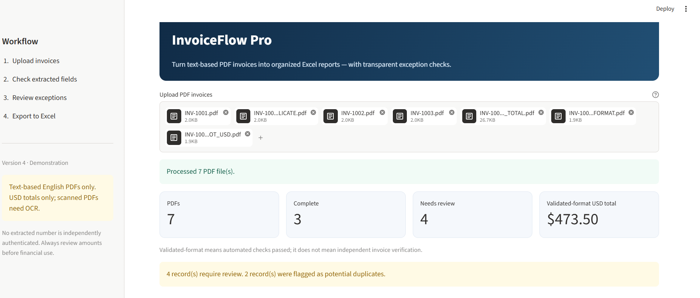

# InvoiceFlow Pro
### PDF Invoice Processing, Data Extraction & Excel Automation

**InvoiceFlow Pro** is a Python-based application that helps businesses extract structured information from PDF invoices, identify potential errors, and generate organized Excel reports.

Built with **Python, Streamlit, Pandas, and PyMuPDF**, the application demonstrates a practical workflow for reducing repetitive invoice data-entry tasks.

## Key Features

- **Batch PDF Processing:** Upload and process multiple PDF invoices.
- **Automated Data Extraction:** Extract invoice numbers, dates, suppliers, customers, and amounts.
- **Duplicate Detection:** Identify potentially duplicated invoices and flag them for manual review.
- **Missing Data Detection:** Detect missing amounts and other required information.
- **Currency Validation:** Flag unsupported or conflicting currencies instead of incorrectly adding them to USD totals.
- **Review Dashboard:** Inspect extracted records and understand why individual invoices require attention.
- **Search and Filtering:** Locate specific invoices and filter processing results.
- **Excel Reporting:** Download structured reports containing invoice details, review items, and summary statistics.
- **CSV Export:** Export records requiring manual review.

## Demonstration Results

The included synthetic test dataset contains seven PDF invoices.

| Metric | Result |
|---|---:|
| PDFs processed | 7 |
| Complete records | 3 |
| Records requiring review | 4 |
| Potential duplicate records | 2 |
| Total from complete USD records | $473.50 |

These results demonstrate the application's automated checks on the included sample files. They do not constitute independent financial verification.

## Technologies Used

- Python
- Streamlit
- Pandas
- PyMuPDF
- OpenPyXL
- Git and GitHub

## Installation and Usage

**1. Clone the repository**

```bash
git clone https://github.com/iamnomid/InvoiceFlow-Pro.git
cd InvoiceFlow-Pro
```

**2. Install dependencies**

```bash
python -m pip install -r requirements.txt
```

**3. Start the application**

```bash
python -m streamlit run app.py
```

**4. Open the local application**

Visit `http://localhost:8501` in your browser.

**5. Test the application**

Upload the synthetic PDF invoices provided in the `samples` folder.git add README.md
## Application Dashboard

